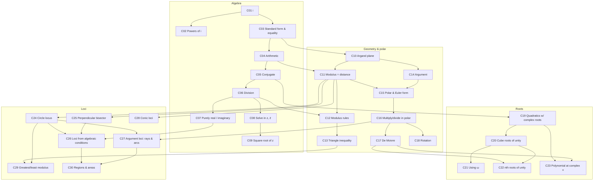

# Complex Numbers — concept graph (M0 draft, for review)

**Status:** approved 2026-10-13 (seeds only: once a concept is written in `concepts/`, its file's misconception table is the source of truth) · **Audience:** Class 11–12 + JEE Mains / NDA / MHT-CET

## Conventions

- **Edge `A ← B`** means "B must be mastered before A unlocks". Only *hard*
  prerequisites go in the graph. "Related" links are left out.
- Edges are **transitively reduced**. If A needs B and B needs C, A does not
  also list C.
- **Ext** marks a prerequisite from another chapter. The app assumes it, and
  may check it with a short diagnostic.
- **Tier:** `core` = every target exam · `adv` = mainly JEE depth.
- **Source** = the PYQ Vault concept slugs to import from: `cn-*` is NDA,
  `cetcn-*` is MHT-CET, `jcx-*` is JEE.

## Map

## Nodes

| ID | Concept (one-liner) | Prereqs | Ext | Tier | Source |
|---|---|---|---|---|---|
| C01 | **The imaginary unit** — i² = −1; why √a·√b = √(ab) fails when both are negative | — | — | core | cn-complex-fundamentals |
| C02 | **Powers of i** — the period-4 cycle; reduce the exponent mod 4 | C01 | — | core | cn-powers-of-i · cetcn-powers-of-i-and-standard-form |
| C03 | **Standard form & equality** — z = x + iy, Re/Im; two complex numbers are equal iff both parts are equal | C01 | — | core | cn-complex-fundamentals · jcx-parts |
| C04 | **Arithmetic** — add, subtract, multiply in x + iy form | C03 | — | core | — (authored) |
| C05 | **Conjugate** — z̄; z + z̄ = 2Re z; conjugate of a sum/product | C04 | — | core | cn-conjugate-and-real-imaginary · cetcn-conjugate-and-rationalising |
| C06 | **Division** — rationalise with the denominator's conjugate; reciprocal | C05 | — | core | cetcn-conjugate-and-rationalising |
| C07 | **Purely real / purely imaginary** — set the *other* part to zero; z = z̄ vs z = −z̄ | C06 | — | core | cn-conjugate-and-real-imaginary · cetcn-purely-real-or-imaginary-condition |
| C08 | **Solving for z** — put z = x + iy, equate parts; equations in z and z̄ | C06 | — | core | cetcn-solve-for-z-with-a-parameter · jcx-equations · cetcn-modulus-plus-z-equation |
| C09 | **Square root of a complex number** — (x + iy)² = a + ib | C08 | — | core | — (authored) |
| C10 | **Argand plane** — z as a point/vector | C03 | coordinates | core | cn-complex-fundamentals |
| C11 | **Modulus as distance** — \|z\|, and \|z₁ − z₂\| = distance between points | C10, C04 | distance formula | core | cn-modulus-properties |
| C12 | **Modulus rules** — \|z₁z₂\| = \|z₁\|\|z₂\|, \|z₁/z₂\|, zz̄ = \|z\|², \|z̄\| = \|z\| | C11, C06 | — | core | cn-modulus-properties · cetcn-modulus-and-its-properties · jcx-modulus · cetcn-find-z-from-a-given-modulus |
| C13 | **Triangle inequality & bounds** — max/min of \|z₁ ± z₂\|, and when a bound is reached | C12 | — | core | cn-modulus-properties · jcx-modulus |
| C14 | **Argument** — principal argument by quadrant, not by tan⁻¹(b/a) alone | C10 | trig values, tan⁻¹ | core | cn-argument-polar · cetcn-argument-and-quadrant · jcx-arg |
| C15 | **Polar & Euler form** — r(cos θ + i sin θ) = re^{iθ} | C11, C14 | — | core | cn-argument-polar · jcx-arg |
| C16 | **Multiply/divide in polar** — moduli multiply, arguments add; arg rules | C15 | compound angles | core | cetcn-polar-form-and-de-moivre |
| C17 | **De Moivre's theorem** — (cos θ + i sin θ)ⁿ; reduce the angle; rewrite sin θ + i cos θ first | C16 | — | core | cn-de-moivre-and-roots · cetcn-polar-form-and-de-moivre · jcx-demoivre |
| C18 | **Rotation** — multiplying by e^{iα} rotates; rotating about a vertex; triangle problems | C16 | — | adv | jcx-rotation |
| C19 | **Quadratics with complex roots** — conjugate-pair roots (real coefficients only); sum & product | C05 | quadratic formula | core | jcx-roots |
| C20 | **Cube roots of unity** — ω³ = 1, 1 + ω + ω² = 0, ω² = ω̄ | C19 | — | core | cn-cube-roots-properties · cetcn-cube-roots-of-unity · jcx-omega |
| C21 | **Using ω** — reducing powers mod 3, factorising expressions, related roots | C20 | — | core | cn-cube-roots-applications |
| C22 | **nth roots of unity** — sum = 0, product, regular-polygon geometry | C17, C20 | — | adv | cn-de-moivre-and-roots · jcx-nth |
| C23 | **Polynomial at a complex x** — use the minimal quadratic instead of substituting directly; powers of the roots | C19, C17 | — | adv | cetcn-minimal-quadratic-and-polynomial-values · jcx-powers |
| C24 | **Circle locus** — \|z − a\| = r: centre a, radius r | C11 | circle equation | core | cetcn-circle-from-modulus-condition · jcx-circle · cn-loci-in-argand-plane |
| C25 | **Perpendicular bisector** — \|z − a\| = \|z − b\| is a line | C11 | line equation | core | cetcn-perpendicular-bisector-and-lines · jcx-line |
| C26 | **Loci from algebraic conditions** — Re/Im of a quotient = 0; \|z − a\| = k\|z − b\| (circle for k ≠ 1) | C24, C25, C07 | — | core | cetcn-real-part-of-a-quotient-is-zero · jcx-ratio |
| C27 | **Argument loci** — arg(z − a) = θ is a ray; a fixed arg of a quotient is an arc | C16, C24 | — | adv | jcx-ratio |
| C28 | **Conic loci** — \|z − a\| ± \|z − b\| = k as ellipse/hyperbola | C11 | conics | adv | jcx-conic |
| C29 | **Greatest/least modulus** — on a disc: \|a\| ± r; check the extreme point lies in the region | C13, C24 | — | core | cetcn-greatest-and-least-modulus-on-a-disc · jcx-extreme |
| C30 | **Regions & areas** — inequalities as shaded regions; area; lattice points | C26, C27 | — | adv | jcx-region |

**Totals:** 30 concepts (24 core, 6 adv) · 39 edges · 8 concepts with external prerequisites.

## Misconception seeds → remediation routing

Most are taken from PYQ Vault's trap callouts. **Fallback** is where a second
miss on the same misconception sends the student.

| Concept | Misconception | Fallback |
|---|---|---|
| C01 | √(−4)·√(−9) = √36 = 6 | — (root) |
| C02 | i³ = i; dividing the exponent mod 4 and misreading the remainder | C01 |
| C03 | Equating parts when the "real" unknowns may themselves be complex | — |
| C05 | Conjugating only part of an expression (e.g. only the numerator) | C04 |
| C06 | Dividing by (1 − i) without rationalising | C05 |
| C07 | "Purely imaginary" ⇒ setting the *imaginary* part to zero | C03 |
| C08 | Squaring both sides and keeping an extraneous root | C06 |
| C11 | \|z₁ + z₂\| = \|z₁\| + \|z₂\| | C10 |
| C12 | zz̄ = \|z\| (instead of \|z\|²); expanding a product to find its modulus | C05 |
| C13 | Stating a bound that is never reached | C11 |
| C14 | arg z = tan⁻¹(b/a) regardless of quadrant; mixing the (−π, π] and [0, 2π) conventions | C10 (quadrant) · Ext: trig (reference angle) |
| C17 | Applying De Moivre directly to sin θ + i cos θ; not reducing the angle | C15 |
| C18 | Rotating about the origin instead of the vertex | C16 |
| C19 | Assuming conjugate-pair roots when coefficients are complex | C05 |
| C20 | ω² = −ω; stopping at ω⁴ without reducing | C02 |
| C22 | Forgetting the root 1 in a sum/product of roots | C20 |
| C23 | Substituting the complex value directly (brute force); mislabelling which root is α | C19 |
| C24 | Reading \|z + 1\| as centred at +1; reporting r² as the radius | C04 |
| C25 | Calling every modulus locus a circle | C11 |
| C26 | Treating k = 1 in \|z − a\| = k\|z − b\| as a circle | C25 |
| C27 | A fixed argument gives the full circle (it is one arc) | C14 |
| C28 | Not comparing the constant with the focal distance (degenerate or empty locus) | C11 |
| C29 | The extreme point lies outside the allowed region | C13 |
| C30 | Shading the wrong side of the bisector | C25 |

## Review checklist

1. **Granularity:** is any node too big (split it) or too small (merge it)?
   Candidates to merge: C03+C04, C11+C12. Candidate to split: C26.
2. **Edges:** is any prerequisite missing or unnecessary? The judgment calls
   are C19 ← C05 only (complex-coefficient quadratics would also need C09)
   and C20 ← C19 (the alternative is the polar route via C17).
3. **Tiers:** are the `adv` tags right for NDA and MHT-CET?
4. **Next M0 step:** fully author 3 concepts, one of each kind:
   **C06 Division** (algebraic), **C14 Argument** (the most misconception-heavy),
   **C25 Perpendicular bisector** (geometric locus).
